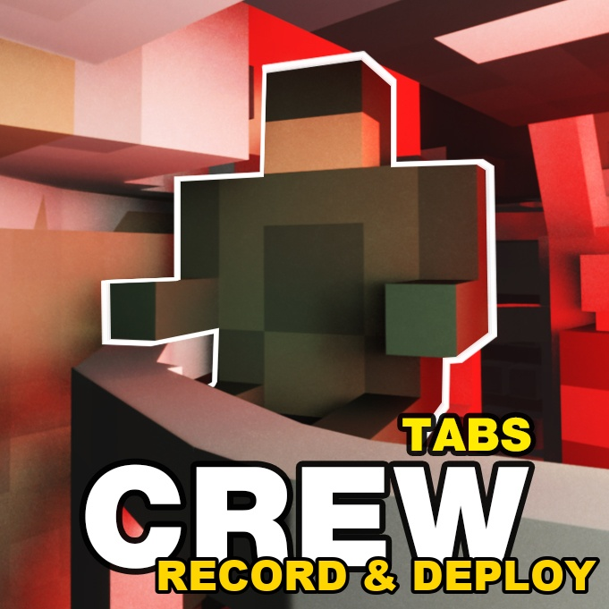

# TABS Crew: Record & Deploy

A fan update of Okidoki's **TABS Crew** for Teardown — War Thunder-style crew simulation for [TABS] vehicles, plus one-key crew deployment.

## Why this exists

The original mod works, but setting up a battle was painful: for every tank you had to noclip inside the hull and hand-place each crew member one by one — then do it all over again for the next identical tank. For TABS-TAK AI battles with dozens of vehicles, preparation took longer than the battle itself.

**Record & Deploy:** set up one vehicle of each type by hand, press **R** to record its crew layout (position + orientation, wall and floor mounts), then aim at any vehicle of that type and press **Y** — the full crew is placed at once, jointed exactly where you put them. Layouts autosave per player, so your library builds itself as you play.

## Controls (rebindable in mod settings)

| Key | Action |
|-----|--------|
| LMB | Place crew |
| RMB | Hide shape under cursor |
| MMB | Reset hidden shapes |
| G | Switch crew / driver |
| T | Rotate wall / floor |
| R | Record layout of aimed vehicle |
| Y | Place recorded layout |

## Rules (unchanged from the original)

- 2+ crew: the vehicle is disabled once only 1 remains. 1 crew: disabled when they die.
- All drivers dead: drive and steering are cut.
- A disabled vehicle drops to 30% health (starts burning with the TABS Effect mod).

## Install

- **Steam Workshop:** subscribe [here](https://steamcommunity.com/sharedfiles/filedetails/?id=3815951830) (requires **[TABS] Vehicle Framework**).
- **Manual:** copy this folder to `Documents/Teardown/mods/`.

Layouts live in your local savegame (`savegame.mod.crewpreset.*`), keyed by vehicle — every player starts empty.

## Credits

- Original **TABS Crew** by [Okidoki](https://steamcommunity.com/sharedfiles/filedetails/?id=3561237115) — crew logic, sounds, UI.
- Record / Deploy update by Andrew.

## License

MIT — see [LICENSE](LICENSE). The original mod's assets remain the work of their author and are included here with credit; if you are the original author and want anything changed, open an issue.
